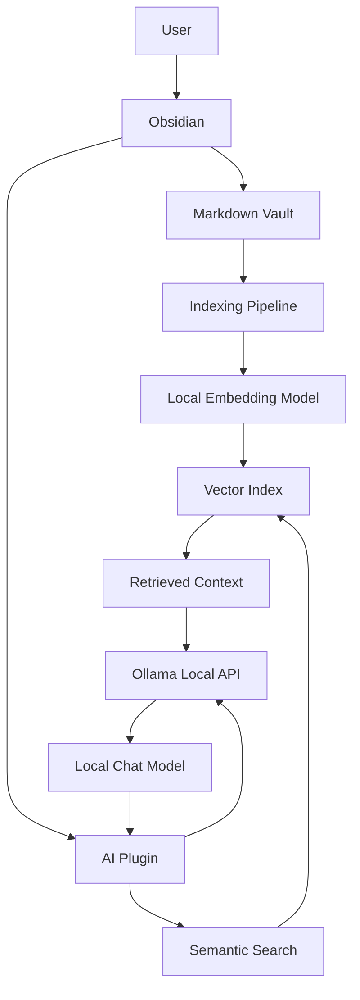
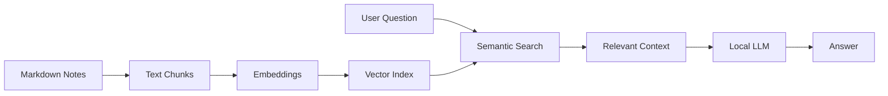

<div align="center">


[](https://obsidian.md/)
[](https://ollama.com/)


[](https://github.com/RufusTheDwarf/obsidian-ai-setup/stargazers)
[](https://github.com/RufusTheDwarf/obsidian-ai-setup/releases)
[](https://github.com/RufusTheDwarf/obsidian-ai-setup/issues)
[](LICENSE)


**Build a local-first, AI-assisted knowledge system.**

[Quick Start](#quick-start) •
[Architecture](#architecture) •
[Security](#security) •
[Troubleshooting](#troubleshooting) •
[Contributing](#contributing)

</div>

---

<a id="overview"></a>
<h2 align="center">Overview // Beyond Traditional Note-Taking</h2>

Obsidian AI Setup is an open-source technical guide
for building an AI-assisted personal knowledge base
using Obsidian, local language models, semantic
embeddings and Retrieval-Augmented Generation.

The goal is to turn a traditional Markdown vault
into a searchable and interconnected knowledge system
without requiring a paid cloud AI subscription.

This repository is a configuration and documentation
project, not a standalone application or Obsidian plugin.

<a id="features"></a>
<h2 align="center">Features // Core Capabilities</h2>

- Local LLM inference with Ollama.
- AI-assisted Markdown note writing.
- Semantic document retrieval.
- Vault-aware conversations using RAG.
- Local embedding generation.
- Knowledge organization and linking.
- Reusable note templates.
- Technical documentation workflows.
- Optional Git-based version control.
- Privacy-oriented configuration.
- Optional cloud AI integration.

These capabilities are provided by the documented
third-party tools and their configuration.

<a id="architecture"></a>
<h2 align="center">Architecture // System Design</h2>



| Component | Responsibility |
|:--|:--|
| Obsidian | Knowledge management interface |
| Markdown | Portable document format |
| Ollama | Local model inference |
| Copilot | AI integration and vault retrieval |
| Embeddings | Semantic document representation |
| Vector index | Similarity-based retrieval |
| RAG | Context-aware answer generation |
| Git | Optional version control |

<a id="requirements"></a>
<h2 align="center">Requirements // System Compatibility</h2>

| Component | Requirement |
|:--|:--|
| Operating system | Windows, Linux or macOS |
| Obsidian | Supported desktop version |
| Ollama | Supported release |
| Memory | 8 GB minimum recommended |
| Recommended memory | 16 GB or more |
| GPU | Optional, recommended for larger models |
| Storage | Depends on downloaded models |
| Internet | Initial installation and model downloads |

Hardware recommendations are estimates. Actual memory
requirements depend on model size, quantization,
context length and available VRAM.

<a id="quick-start"></a>
<h2 align="center">Quick Start // Installation</h2>

### Install Obsidian

Download Obsidian:

https://obsidian.md/download

Create a dedicated vault, for example:

```text
AI-Knowledge-Vault
```

### Install Ollama

Download Ollama:

https://ollama.com/download

On Linux, inspect the official installation script
before executing it:

```bash
curl -fsSL https://ollama.com/install.sh -o install.sh
less install.sh
sh install.sh
```

Verify the installation:

```bash
ollama --version
```

### Download the models

Use a lightweight conversation model:

```bash
ollama pull qwen2.5:3b
```

Or a larger alternative:

```bash
ollama pull qwen2.5:7b
```

Download an embedding model:

```bash
ollama pull nomic-embed-text
```

List the installed models:

```bash
ollama list
```

Test local inference:

```bash
ollama run qwen2.5:3b
```

Enter `/bye` to exit.

### Start the local API

Ollama normally exposes its API on:

```text
http://127.0.0.1:11434
```

If Ollama is not already running:

```bash
ollama serve
```

Only one server should listen on this port.

<a id="models"></a>
<h2 align="center">Models // Choosing Your AI Engine</h2>

| Model | Purpose | Download size |
|:--|:--|--:|
| `qwen2.5:3b` | Lightweight chat | 1.9 GB |
| `qwen2.5:7b` | General-purpose chat | 4.7 GB |
| `qwen2.5:14b` | Larger chat model | 9 GB |
| `nomic-embed-text` | Embeddings | 274 MB |

Download sizes are approximate and do not represent
total runtime memory consumption.

Review the upstream license before using or
redistributing any model.

<a id="plugins"></a>
<h2 align="center">Plugins // Extending Obsidian</h2>

Open:

```text
Settings > Community plugins
```

Review the security implications of community plugins
before disabling Restricted mode.

Install the following plugins from the community
plugin directory.

| Plugin | Purpose | Required |
|:--|:--|:--:|
| Copilot | Local AI chat and vault Q&A | Yes |
| Dataview | Knowledge queries | No |
| Templater | Advanced note templates | No |
| Git | Vault version control | No |

Plugin repositories:

- [Copilot](https://github.com/logancyang/obsidian-copilot)
- [Dataview](https://github.com/blacksmithgu/obsidian-dataview)
- [Templater](https://github.com/SilentVoid13/Templater)
- [Obsidian Git](https://github.com/Vinzent03/obsidian-git)

Install only the plugins you actually need.

<a id="configuration"></a>
<h2 align="center">Configuration // Connecting Local AI</h2>

Open the Copilot plugin settings.

Add or select an Ollama-backed chat model using
the following values.

| Setting | Value |
|:--|:--|
| Provider | Ollama |
| Server URL | `http://127.0.0.1:11434` |
| Chat model | `qwen2.5:3b` |
| Embedding provider | Ollama |
| Embedding model | `nomic-embed-text` |

Select the local model for chat and configure
the embedding model for vault Q&A.

Exact settings and available features may vary
between plugin versions.

### Configure CORS if required

If the plugin cannot reach Ollama because of an
origin restriction, allow the Obsidian application
origin without exposing the server to the LAN.

On Windows, quit the existing Ollama application,
then open PowerShell:

```powershell
$env:OLLAMA_HOST = "127.0.0.1:11434"
$env:OLLAMA_ORIGINS = "app://obsidian.md*"

ollama serve
```

On Linux, for a manually launched server:

```bash
OLLAMA_HOST=127.0.0.1:11434 \
OLLAMA_ORIGINS='app://obsidian.md*' \
ollama serve
```

For a systemd-managed installation, configure these
environment variables through a service override
instead of launching a second server.

On macOS:

```bash
launchctl setenv OLLAMA_ORIGINS 'app://obsidian.md*'
```

Quit and restart the Ollama application.

<a id="rag"></a>
<h2 align="center">RAG // Retrieval-Augmented Generation</h2>

RAG retrieves relevant document fragments before
providing them to a language model.

It does not retrain the model on your documents.



### Indexing workflow

1. Configure the embedding model.
2. Exclude confidential folders where supported.
3. Open the vault Q&A feature.
4. Build or refresh the vault index.
5. Ask a question about existing notes.
6. Verify the answer against the original documents.

Rebuild the index after changing embedding models.

Semantic search can miss relevant documents.
Retrieved text and generated answers must be checked
before being used for critical decisions.

<a id="vault"></a>
<h2 align="center">Vault // Knowledge Organization</h2>

Recommended vault structure:

```text
AI-Knowledge-Vault/
├── 00-Inbox/
├── 01-Projects/
├── 02-Knowledge/
│   ├── Development/
│   ├── DevOps/
│   ├── Networking/
│   ├── Cybersecurity/
│   ├── Linux/
│   └── Databases/
├── 03-Documentation/
├── 04-Labs/
├── 05-Research/
├── 06-Personal/
├── 07-Templates/
├── 08-Attachments/
├── 09-Archive/
└── .obsidian/
```

Use folders for broad categories and internal links
to connect related concepts.

Example:

```markdown
# Docker Networking

## Overview

Docker provides isolated network environments
for containerized applications.

## Related concepts

- [[Linux Networking]]
- [[Container Security]]
- [[Docker Compose]]
- [[TCP-IP]]

#docker #networking #devops
```

<a id="templates"></a>
<h2 align="center">Templates // Structured Knowledge</h2>

Example technical note template:

```markdown
---
title:
created: {{date}}
status: draft
tags:
  - documentation
---

# Overview

## Objective

## Prerequisites

## Implementation

## Commands

## Validation

## Troubleshooting

## References

## Related Notes
```

The `{{date}}` placeholder is supported by Obsidian's
core Templates plugin.

Enable the plugin and configure the template folder
before inserting templates.

Templater can be added for more advanced workflows.

<a id="prompts"></a>
<h2 align="center">Prompts // AI-Assisted Workflows</h2>

### Knowledge retrieval

```text
Answer using the retrieved vault notes.

Identify the source notes and distinguish verified
facts from assumptions.

If the available context is insufficient, say so.
```

### Technical documentation

```text
Convert the selected notes into clear technical
documentation.

Include prerequisites, commands, implementation,
validation, security considerations and rollback
instructions where appropriate.

Do not invent commands or configuration values.
```

### Troubleshooting

```text
Analyze the provided logs and technical notes.

Identify probable causes, propose diagnostic checks
and recommend a targeted correction.

Separate confirmed findings from hypotheses.
```

<a id="security"></a>
<h2 align="center">Security // Privacy by Design</h2>

Local inference reduces the need to transmit documents
to external AI providers, but it does not automatically
make the entire vault private or secure.

### Security recommendations

- Keep Ollama bound to the loopback interface.
- Never expose its API directly to the Internet.
- Review community plugins before installation.
- Avoid storing passwords and private keys in notes.
- Use a dedicated password manager.
- Enable full-disk encryption where appropriate.
- Review AI-generated changes before applying them.
- Maintain backups independently of Git.
- Treat retrieved documents as untrusted input.
- Disable unused cloud integrations and sync services.

### Git exclusions

If using Git for the vault, start with a conservative
`.gitignore` file:

```gitignore
.obsidian/
.trash/
.env
.env.*
*.pem
*.key
*.pfx
*.log
Private/
Secrets/
```

Review additional plugin storage and index folders
before committing any files.

A `.gitignore` file does not remove secrets already
committed to Git history.

Use a private repository for personal notes and
verify every commit before pushing.

<a id="validation"></a>
<h2 align="center">Validation // Testing Your Setup</h2>

### Check the local API

```bash
curl http://127.0.0.1:11434/api/tags
```

PowerShell alternative:

```powershell
Invoke-RestMethod http://127.0.0.1:11434/api/tags
```

### Test embedding generation

```bash
curl http://127.0.0.1:11434/api/embed \
  -H "Content-Type: application/json" \
  -d '{
    "model": "nomic-embed-text",
    "input": "Docker networking"
  }'
```

### Functional checklist

- [ ] Obsidian is installed.
- [ ] Ollama responds on localhost.
- [ ] The chat model generates answers.
- [ ] The embedding model returns vectors.
- [ ] Copilot connects to Ollama.
- [ ] Vault indexing completes.
- [ ] Vault Q&A retrieves a known test note.
- [ ] Answers are checked against their sources.
- [ ] Confidential notes are excluded.
- [ ] Offline functionality has been verified.

For an offline test, download all required models
and plugins first, then disconnect from the Internet.

<a id="troubleshooting"></a>
<h2 align="center">Troubleshooting // Common Issues</h2>

| Problem | Possible solution |
|:--|:--|
| Connection refused | Check whether Ollama is running |
| HTTP 403 | Review allowed origins |
| Address already in use | Stop the duplicate server |
| Model not found | Download the correct model tag |
| Slow generation | Use a smaller model |
| Out of memory | Reduce model or context size |
| Empty vault results | Refresh the document index |
| Incorrect retrieval | Review note content and embedding configuration |

Useful commands:

```bash
ollama list
ollama ps
ollama --version
```

<a id="roadmap"></a>
<h2 align="center">Roadmap // Future Development</h2>

- [ ] Validate the setup on Windows.
- [ ] Validate the setup on Linux.
- [ ] Validate the setup on macOS.
- [ ] Provide a starter vault.
- [ ] Add reusable prompt templates.
- [ ] Add automated installation scripts.
- [ ] Document GPU acceleration.
- [ ] Benchmark local language models.
- [ ] Compare embedding models.
- [ ] Explore local MCP integrations.
- [ ] Add security-hardening documentation.
- [ ] Add reproducible configuration examples.

<a id="references"></a>
<h2 align="center">References // Official Documentation</h2>

- [Obsidian Help](https://help.obsidian.md/)
- [Obsidian Plugin Security](https://obsidian.md/help/Extending+Obsidian/Plugin+security)
- [Ollama Documentation](https://docs.ollama.com/)
- [Ollama Model Library](https://ollama.com/library)
- [Qwen Models](https://ollama.com/library/qwen2.5)
- [Nomic Embed Text](https://ollama.com/library/nomic-embed-text)
- [Copilot for Obsidian](https://github.com/logancyang/obsidian-copilot)
- [Local Copilot Configuration](https://github.com/logancyang/obsidian-copilot/blob/master/local_copilot.md)

<a id="contributing"></a>
<h2 align="center">Contributing // Open Knowledge</h2>

Contributions are welcome.

```bash
git clone https://github.com/RufusTheDwarf/obsidian-ai-setup.git
cd obsidian-ai-setup
git switch -c docs/improve-guide
```

Submit a pull request containing clear and
reproducible improvements.

Never include personal vault content, credentials
or private API keys in contributions.

<h2 align="center">License // Open Source</h2>

The original documentation in this repository is
released under the [MIT License](LICENSE).

Third-party applications, plugins and AI models
remain subject to their respective licenses.

This project is independent and is not affiliated
with Obsidian or Ollama.

---

<div align="center">

**Built for curious minds and independent developers.**

Maintained by
[RufusTheDwarf](https://github.com/RufusTheDwarf).

If this project helps you, consider starring
the repository or contributing an improvement.


</div>
